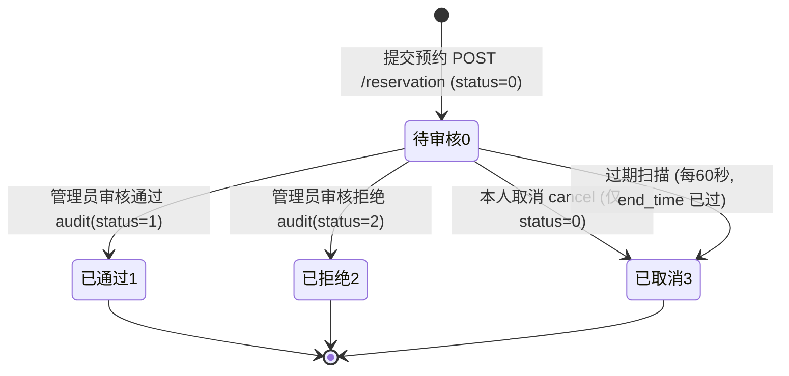

# 基础业务系统交接文档（面向阶段②-⑤ 智能体搭建）

## 0. 文档元信息


* 项目名称：智能实验室预约系统（工程目录 `lab-agent`，含 `backend/` 与 `frontend/`）

* 当前阶段：阶段①基础业务系统已落地；阶段②大模型、③ RAG、④ Tool Calling、⑤ LangGraph 尚未在当前代码中实现。

* 总结目的：将已实现业务整理为可供后续 AI 工具化、检索和编排复用的唯一上下文。

* 资料可信度：业务事实以当前后端 / 前端源码为高可信依据；路线以 `教程/项目路线讲解.md`、`教程/项目路线讲解(1-8).md` 和思维导图为规划参考。未发现单独的 “架构复盘” 文件；源码与教程冲突时，以当前源码为准。

* 缺失信息处理方式：不补造字段、接口路径、类名、技术栈或状态枚举；缺少证据的内容标为【待确认】，架构建议标为【推断】。API 路由统一由 `api/__init__.py` 加 `/api` 前缀；表中省略此前缀的业务路径为 router 内路径片段。


***

## 1. 一句话定位

这是一个按路线资料使用 Vue3、FastAPI、SQLAlchemy 与 MySQL 构建的实验室预约系统，当前代码已具备账号鉴权、用户 / 实验室 / 设备管理、学生预约、管理员审核和过期待审核预约自动取消；其 API、Service、权限依赖与预约状态为后续封装 Tool、整理 RAG 知识和编排 LangGraph 提供了业务基础，但 AI 阶段本身尚未实现。


***

## 2. 已实现范围与未完成范围


| 阶段 | 模块                             | 状态                          | 证据（源码事实）                                                                                   | 对 Agent 的意义                  |
| -- | ------------------------------ | --------------------------- | ------------------------------------------------------------------------------------------ | ---------------------------- |
| ①  | 前端基础（Vite/Vue3 / 路由 /axios 封装） | ✅已实现                        | `utils/request.js`、`router/index.js`、`layouts/Layout.vue`                                  | 未来对话式入口可挂在同一布局内              |
| ①  | 后端基础（FastAPI、CORS、统一响应 / 异常）   | ✅已实现                        | `main.py`、`common/response.py`、`common/exceptions.py`                                      | Tool 调用结果可直接复用统一响应结构         |
| ①  | 登录 / 注册 / JWT                  | ✅已实现                        | `api/auth.py`、`services/auth_service.py`、`utils/jwt.py`（算法默认 HS256、时长默认 24h，可由环境覆盖）        | Agent 以 "代表某用户" 方式调用工具时复用其身份 |
| ①  | 统一异常 / 响应 / 分页                 | ✅已实现                        | `Response(code,message,data)`、`PageResponse(list,total)`                                   | 工具错误信息天然可读，可直接回喂大模型          |
| ①  | 前后端联调 / 文件上传                   | ✅已实现                        | `api/files.py` POST `/api/files/upload`，`/uploads` 静态目录                                    | RAG 图片 / 附件能力的基础             |
| ①  | 个人信息 / 修改密码                    | ✅已实现                        | `/user/me`、`/user/me/password`                                                             | 一般不直接暴露为工具                   |
| ①  | 用户管理（列表 / 增删改，管理员）             | ✅已实现                        | `api/user.py`、`services/user_service.py`                                                   | 可包装为管理员侧管理工具                 |
| ①  | 实验室管理 CRUD（管理员）                | ✅已实现                        | `models/lab.py`、`api/lab.py`、`services/lab_service.py`                                     | RAG 知识源 + 查询工具               |
| ①  | 设备管理 CRUD（管理员，外键关联实验室）         | ✅已实现（含已知缺陷，见第 11 节）         | `models/equipment.py`、`services/equipment_service.py`                                      | RAG 知识源 + 查询工具               |
| ①  | 学生端实验室 / 设备只读列表                | ✅已实现（"关闭实验室过滤" 未闭环，见第 11 节） | `views/LabList.vue`、`views/LabEquipment.vue`、GET `/lab/list`、`/lab/{id}`、`/equipment/list` | 查询类工具的高频入口                   |
| ①  | 提交预约（多表校验 + 时间冲突检测）            | ✅已实现                        | `services/reservation_service.py::create_reservation`                                      | 最高价值的 Agent 写操作工具            |
| ①  | 我的预约 / 取消                      | ✅已实现（仅 "待审核" 可取消）           | GET `/reservation/list`、PUT `/reservation/{id}/cancel`                                     | 工具 + 状态机边                    |
| ①  | 管理员审核（通过 / 拒绝）                 | ✅已实现                        | PUT `/reservation/{id}/audit`                                                              | 人工审核中断（Human-in-the-loop）节点  |
| ①  | 过期待审核自动取消                      | ✅已实现                        | `run_expire_scan` + `main.py` lifespan，60 秒 / 次                                            | 定时事件范式，可扩展提醒 / 自动审核          |
| ①  | 首页统计                           | 可选增强                        | 当前 `views/Home.vue` 未见统计接口调用；是否纳入阶段①范围【待确认】                                                | 后续可提供聚合数据查询工具                |
| ①  | 删除外键保护（使用中不能删）                 | 可选增强（未实现）                   | Service 删除逻辑未先检查关联记录；存在设备 / 预约时由外键约束阻止删除，错误未转成明确业务提示                                       | 写操作护栏候选                      |
| ①  | 设备归属一致性校验                      | 可选增强（未实现）                   | 预约创建校验设备存在与状态，但未校验设备的 `lab_id` 与请求 `lab_id` 一致                                             | 预约写操作护栏                      |
| ①  | 容量 / 数量参与预约                    | 可选增强（规则待确认）                 | `labs.capacity`、`equipments.quantity` 字段存在，当前预约冲突逻辑未按容量 / 数量计算                             | 需先确认资源占用规则                   |
| ②  | 大模型接入                          | 未来阶段                        | 无                                                                                          | 智能对话底座                       |
| ③  | RAG 知识库                        | 未来阶段                        | 无                                                                                          | 实验室 / 设备 / 规则知识检索            |
| ④  | Tool Calling                   | 未来阶段                        | 无                                                                                          | 调用现有 Service 完成业务            |
| ⑤  | LangGraph Agent                | 未来阶段                        | 无                                                                                          | 状态机编排、人工审核中断、记忆              |


***

## 3. 领域模型与数据关系

所有表继承 `Base`，公共字段：`id`（主键自增）、`create_time`、`update_time`（`database.py`）。


| 实体          | 表名 / 职责                    | 关键字段（类型与枚举）                                                                                                                                                                                                                                                                                     | 外键关系                                         | 生命周期                                    | Agent 用途          |
| ----------- | -------------------------- | ----------------------------------------------------------------------------------------------------------------------------------------------------------------------------------------------------------------------------------------------------------------------------------------------- | -------------------------------------------- | --------------------------------------- | ----------------- |
| User        | `users`，系统用户               | username String (50) 非空；password String (255)（存 bcrypt 哈希）；name String (50) 非空；role String (50)，模型注释约定 `student`/`admin`（Schema 未使用枚举约束）；email、phone、avatar 可空；status int，`0`禁用 /`1`正常，默认 1                                                                                                     | 被 reservations.user\_id 引用                   | 注册创建为正常学生；管理员可改角色 / 状态；删除规则受预约外键影响【待确认】 | 身份主体；Agent 以其名义操作 |
| Lab         | `labs`，实验室资源               | name String (50) 非空（名称唯一，Service 层校验）；location String (100)；capacity int（默认 0，**预约未使用**）；open\_time、close\_time String(20)（"HH:mm"）；description String(500)；img String(200)；status int `0`关闭 /`1`开放，默认 1                                                                                        | 被 equipments.lab\_id、reservations.lab\_id 引用 | 开放 (1)↔关闭 (0)；可新增 / 改名 / 删除（删除保护缺失）     | RAG 知识主体；查询工具     |
| Equipment   | `equipments`，实验室设备         | lab\_id int 非空 FK→labs.id；name String (50) 非空；description String (500)；img String (200)；spec String (100)；quantity int 默认 1（**预约未使用**）；status int `0`维修 /`1`正常，默认 1；ORM `lab = relationship()`                                                                                                  | 多对一 Lab；被 reservations.equipment\_id 引用      | 正常 (1)↔维修 (0)；可增删改                      | RAG 知识主体；预约对象     |
| Reservation | `reservations`，预约记录（核心交易表） | user\_id int 非空 FK→users.id；lab\_id int 非空 FK→labs.id；equipment\_id int 可空 FK→equipments.id（**空 = 只约实验室**）；date String (20)（"YYYY-MM-DD"）；start\_time、end\_time String (20)（"HH:mm"）；remark String (255)；status int 默认 `0`，枚举 `0`待审核 /`1`已通过 /`2`已拒绝 /`3`已取消；三个 relationship：user、lab、equipment | 多对一 User、Lab、Equipment（equipment 可空）         | 完整状态机，见第 6 节                            | Agent 核心写操作与状态图载体 |

关系基数（由模型外键可知）：


* Lab 1 — N Equipment；User 1 — N Reservation；Lab 1 — N Reservation；Equipment 1 — N Reservation。

* 预约列表通过 relationship 拼装非持久化字段：`user_name`、`lab_name`、`equipment_name`、`type`（"设备"/"实验室"，按 equipment\_id 是否为空计算）。


***

## 4. 角色与权限矩阵


| 角色            | 可访问资源              | 可执行动作                                                                                                                                                                                                               | 数据范围                                                                            | 对应鉴权点                                                         | Agent 暴露边界                      |
| ------------- | ------------------ | ------------------------------------------------------------------------------------------------------------------------------------------------------------------------------------------------------------------- | ------------------------------------------------------------------------------- | ------------------------------------------------------------- | ------------------------------- |
| 游客（未登录）       | 登录、注册；无鉴权上传接口      | POST `/api/auth/login`、`/api/auth/register`、POST `/api/files/upload`                                                                                                                                                | —                                                                               | 无                                                             | Agent 不直接托管密码；可引导登录             |
| 学生 student    | 实验室 / 设备只读；预约；本人资料 | GET `/api/lab/list`、`/api/lab/{lab_id}`、`/api/equipment/list`；POST `/api/reservation`；GET `/api/reservation/list`；PUT `/api/reservation/{reservation_id}/cancel`；GET/PUT `/api/user/me`、PUT `/api/user/me/password` | 预约列表**仅本人**（Service 中 `user_id == current_user.id`）；`user_id` 由 token 注入、禁止前端传入 | `get_current_user`；取消时 Service 校验 `user_id` 归属                | Agent 默认以学生身份运行；只能查 / 约 / 取消本人单 |
| 管理员 admin     | 全部资源               | 学生全部读权限 + 用户 / 实验室 / 设备的 POST/PUT/DELETE + GET `/api/user/list`、POST `/api/user`、PUT/DELETE `/api/user/{user_id}` + PUT `/api/reservation/{reservation_id}/audit`                                                   | 预约列表全部；可看全部用户                                                                   | `get_current_admin`（嵌套依赖 get\_current\_user，再判 role=="admin"） | 管理类工具（审核、资源维护）需显式确认管理员身份，建议二次确认 |
| 系统后台任务（非用户角色） | reservations 表     | 扫描 status=0 且已过期的记录置为 3                                                                                                                                                                                             | 全表                                                                              | 无 HTTP 入口；`main.py` lifespan 启动，使用独立 `SessionLocal`           | 未来定时类 Agent 事件（提醒、自动审核）的模板      |

鉴权实现事实：


* Token 走 `Authorization: Bearer <token>`，OAuth2PasswordBearer，tokenUrl=`/api/auth/login`；JWT 负载含 `user_id`、`exp`，算法默认 HS256、有效期默认 24 小时，可由环境配置覆盖。

* `get_current_user` 依次校验：解码成功 → 用户存在 → `status==1`（禁用即 401）。

* 鉴权失败走 HTTPException（401）；业务无权限（如非 admin）走 `BusinessException(code=403)`，**HTTP 状态码为 200、业务 code 在响应体中**。

* 遗留：POST `/files/upload` **无任何鉴权依赖**（技术债）；`get_current_user` 每次请求都会读取数据库并检查用户状态，因此禁用用户后其 JWT 会立即无法通过该依赖。密码变更没有令牌撤销 / 版本检查，已签发 JWT 在过期前仍可用；过期时长配置默认 24 小时，可由环境配置覆盖。


***

## 5. 核心业务能力清单


| 编号  | 模块   | 能力                        | 触发角色        | 输入                                                        | 输出                                                        | 状态变化                         | 业务规则与闸门                                                                                                              | 涉及实体                              | Service / API                                                             | Agent 化候选                              |
| --- | ---- | ------------------------- | ----------- | --------------------------------------------------------- | --------------------------------------------------------- | ---------------------------- | -------------------------------------------------------------------------------------------------------------------- | --------------------------------- | ------------------------------------------------------------------------- | -------------------------------------- |
| C01 | 账号   | 登录                        | 游客          | username、password                                         | token + UserResponse                                      | —                            | 用户存在且密码正确（bcrypt）；status=1                                                                                           | User                              | auth\_service.login；POST `/auth/login`                                    | 一般不做工具（身份层）                            |
| C02 | 账号   | 注册                        | 游客          | username、password、name?                                   | 成功消息                                                      | 新建用户固定 role=student、status=1 | username 查重；密码 hash                                                                                                  | User                              | auth\_service.register；POST `/auth/register`                              | 一般不做工具                                 |
| C03 | 账号   | 获取 / 修改本人资料               | 学生 / 管理员    | 表单字段                                                      | UserResponse                                              | —                            | 自助修改排除 role/status/password（注：**未排除 username**，缺口）                                                                   | User                              | user\_service；GET/PUT `/user/me`                                          | 不建议                                    |
| C04 | 账号   | 修改密码                      | 学生 / 管理员    | old\_password、new\_password                               | 成功消息                                                      | password 更新                  | 校验原密码；新密码不得与旧密码相同；hash 后存储                                                                                           | User                              | PUT `/user/me/password`                                                   | 否                                      |
| C05 | 公共   | 文件上传                      | 任意（**无鉴权**） | multipart 文件                                              | original\_name、disk\_name、size、url(`/uploads/...`)        | —                            | 后缀白名单（jpg/jpeg/png/gif/webp/pdf/doc/docx/xls/xlsx/zip）；当 `file.size` 可用且大于 100MB 时拒绝；时间戳 + uuid 重命名；取 basename 防路径穿越 | File                              | files.upload；POST `/files/upload`                                         | RAG 附件入口（需先补鉴权及解析 / 入库能力）              |
| C06 | 用户管理 | 分页 / 搜索用户                 | 管理员         | page、page\_size、keywords?                                 | PageResponse                                              | —                            | username/name 模糊（ilike + or\_）；id 倒序                                                                                 | User                              | user\_service.get\_user\_page\_list；GET `/user/list`                      | 管理工具（低优先）                              |
| C07 | 用户管理 | 新增 / 编辑 / 删除用户            | 管理员         | 表单 /user\_id                                              | UserResponse / 空                                          | 用户状态可改                       | 新增 username 查重、密码 hash；不能删除当前登录账号                                                                                    | User                              | POST `/user`、PUT/DELETE `/user/{id}`                                      | 管理工具（低优先）                              |
| C08 | 实验室  | 分页列表（管理 / 学生）             | 登录用户        | page、page\_size、keywords?（路由不接收 status）                   | PageResponse                                              | —                            | name 模糊；Service 有 status 参数但路由未接线，且 `if status:` 使 0 值无法作为过滤条件                                                       | Lab                               | lab\_service.get\_lab\_page\_list；GET `/lab/list`                         | ✅ query\_lab（开放状态筛选需补齐）                |
| C09 | 实验室  | 单条详情                      | 登录用户        | lab\_id                                                   | LabResponse                                               | —                            | 不存在抛 "实验室不存在"                                                                                                        | Lab                               | lab\_service.get\_lab；GET `/lab/{id}`                                     | ✅ query\_lab\_detail                   |
| C10 | 实验室  | 新增 / 编辑 / 删除              | 管理员         | 表单 /lab\_id                                               | LabResponse / 空                                           | Lab 增删改                      | name 唯一；更新时排除自身；删除保护缺失                                                                                               | Lab                               | POST `/lab`、PUT/DELETE `/lab/{id}`                                        | 管理工具                                   |
| C11 | 设备   | 分页列表（可按 lab\_id、keywords） | 登录用户        | page、page\_size、keywords?、lab\_id?                        | PageResponse（含拼装 lab\_name）                               | —                            | 按 lab\_id 过滤；name 模糊；每行经 relationship 取 lab\_name（N+1）                                                               | Equipment, Lab                    | equipment\_service.get\_equipment\_page\_list；GET `/equipment/list`       | ✅ query\_equipment                     |
| C12 | 设备   | 新增 / 编辑 / 删除              | 管理员         | 表单 /equipment\_id                                         | 响应 / 空                                                    | Equipment 增删改                | 编辑校验实验室存在；同一实验室同名唯一（编辑已按 lab\_id 限定，**新增查重未按 lab\_id 限定且未校验实验室存在**，缺口）                                               | Equipment, Lab                    | POST `/equipment`、PUT/DELETE `/equipment/{id}`                            | 管理工具                                   |
| C13 | 预约   | 提交预约                      | 学生（登录）      | lab\_id、equipment\_id?、date、start\_time、end\_time、remark? | 成功                                                        | **新建 status=0**              | 见 C13 规则链                                                                                                            | User, Lab, Equipment, Reservation | reservation\_service.create\_reservation；POST `/reservation`              | ✅✅ create\_reservation（最高优先）           |
| C14 | 预约   | 分页查询（我的 / 全部）             | 学生 / 管理员    | page、page\_size、status?                                   | PageResponse（含 user\_name/lab\_name/equipment\_name/type） | —                            | 非 admin 强制只看本人；可按 status 过滤                                                                                          | Reservation 等                     | reservation\_service.get\_reservation\_page\_list；GET `/reservation/list` | ✅ list\_my\_reservations / admin\_list |
| C15 | 预约   | 取消                        | 本人          | reservation\_id                                           | 成功                                                        | **status→3**                 | 记录存在；必须本人；**仅 status=0 可取消**                                                                                         | Reservation                       | reservation\_service.cancel\_reservation；PUT `/reservation/{id}/cancel`   | ✅ cancel\_reservation                  |
| C16 | 预约   | 审核                        | 管理员         | reservation\_id、status(1/2)                               | 成功                                                        | **status→1 或 2**             | 入参状态仅允许 1/2；仅 status=0 可审核                                                                                           | Reservation                       | reservation\_service.audit\_reservation；PUT `/reservation/{id}/audit`     | ✅ approve/reject（人工中断节点）               |
| C17 | 定时   | 过期待审核自动取消                 | 后台任务        | 无（每 60 秒）                                                 | 无                                                         | **status 0→3**               | 仅扫 status=0；date 早于今天，或当天且 end\_time≤当前时间；独立 SessionLocal                                                            | Reservation                       | expire\_pending\_reservations / run\_expire\_scan（lifespan）               | 定时事件模板                                 |
| C18 | 可选增强 | 首页统计                      | 【待确认】       | —                                                         | —                                                         | —                            | 无实现                                                                                                                  | 多表                                | 无                                                                         | 数据问答工具                                 |
| C19 | 可选增强 | 删除外键保护                    | 管理员侧补齐      | lab\_id/equipment\_id                                     | —                                                         | —                            | 有设备或预约时拒绝删除实验室；有预约时拒绝删除设备；当前 Service 未做关联预查，数据库外键可能使删除失败                                                             | Lab/Equipment/Reservation         | 无                                                                         | 护栏                                     |
| C20 | 可选增强 | 预约设备归属校验                  | 提交预约时补齐     | lab\_id + equipment\_id                                   | —                                                         | —                            | 校验 equipment.lab\_id == lab\_id                                                                                      | Equipment, Reservation            | 无                                                                         | 护栏                                     |

**C13 提交预约的完整规则链（按 Service 实际顺序）**：


1. date 不得早于今天；

2. end\_time 不得早于 start\_time；

3. 当天预约 start\_time 不得早于当前时间；

4. 实验室存在且 status=1（开放）；

5. start\_time 不早于 lab.open\_time、end\_time 不晚于 lab.close\_time（开放时间存在时）；

6. 若带 equipment\_id：设备存在且 status=1（正常）；

7. 冲突检测：同 lab\_id + 同 date + 已存在记录 status∈{0,1} + 时段重叠（`已有.start < 新end 且 已有.end > 新start`）；约设备额外限定 equipment\_id 相同，约实验室限定 equipment\_id IS NULL；

8. 通过后写入 status=0。当前只拒绝 `end_time < start_time`，未明确拒绝相等时间；后端也未强制校验日期 / 时间字符串格式，Agent 入参需要额外规范化并保留 Service 校验。

   注：约实验室与约设备按当前实现**互不构成冲突**（教程明确设计）；时间比较依赖字符串零填充字典序。


***

## 6. 业务状态机与生命周期

### 6.1 预约状态机（唯一有完整生命周期的核心对象）





| 当前状态  | 允许迁移   | 触发者  | 前置条件                                                   | 异常分支（实际提示）                      |
| ----- | ------ | ---- | ------------------------------------------------------ | ------------------------------- |
| 待审核 0 | →已通过 1 | 管理员  | 调 audit，入参 status=1；记录存在                               | "当前状态不支持审核"/"审核状态错误"/"无权限访问"    |
| 待审核 0 | →已拒绝 2 | 管理员  | 入参 status=2；记录存在                                       | 同上                              |
| 待审核 0 | →已取消 3 | 本人   | 调 cancel；user\_id 必须是本人                                | "预约记录不存在"/"无权限"(403)/"当前状态无法取消" |
| 待审核 0 | →已取消 3 | 后台任务 | date 早于今天，或当天 end\_time≤now；仅扫描 status=0               | 无（静默）                           |
| 已通过 1 | 终态     | —    | 代码中**不允许**取消 / 再审（注：教程文字曾称 "已通过可取消"，实际代码与前端均不允许，以代码为准） | "当前状态无法取消"                      |
| 已拒绝 2 | 终态     | —    | 不允许迁移                                                  | —                               |
| 已取消 3 | 终态     | —    | 不允许迁移；时段释放、可被新预约占用                                     | —                               |

补充：冲突检测只把 status ∈ {0,1} 视为占用，{2,3} 不阻挡新预约。

### 6.2 其他对象的状态字段


| 对象          | 状态枚举        | 是否有显式流转逻辑                               |
| ----------- | ----------- | --------------------------------------- |
| User        | 0 禁用 / 1 正常 | 仅管理员编辑；登录与 get\_current\_user 校验 1；无状态机 |
| Lab         | 0 关闭 / 1 开放 | 仅管理员编辑；预约时校验 1；学生端过滤未闭环（缺口）             |
| Equipment   | 0 维修 / 1 正常 | 仅管理员编辑；预约设备时校验 1；学生端按钮 disabled 仅为前端展示  |
| Reservation | 0/1/2/3     | 完整状态机（本节核心）                             |


***

## 7. 横切能力与复用范式


| 横切能力   | 实现位置                                    | 事实                                                                                  | 未来智能体复用方式                                   |
| ------ | --------------------------------------- | ----------------------------------------------------------------------------------- | ------------------------------------------- |
| JWT 身份 | `utils/jwt.py`、`dependencies/auth.py`   | 算法默认 HS256、时长默认 24h；依赖注入获取 current\_user/admin                                      | 工具调用时透传用户身份，实现 "代用户执行" 与数据隔离                |
| 统一响应   | `common/response.py`                    | Response{code,message,data}；PageResponse{list,total}                                | 工具结果直接转成模型可读 JSON；失败 message 直接作为模型反馈       |
| 统一异常   | `common/exceptions.py`                  | BusinessException (message,code=500)，业务异常 HTTP 200 + 体 code；422 参数校验；500 兜底         | 护栏失败的标准反馈通道；工具层无需重复定义错误结构                   |
| 数据库会话  | `database.py`                           | get\_db 请求级会话；SessionLocal 供后台任务                                                    | Tool 用 get\_db；定时 / Agent 长任务用 SessionLocal |
| 分页     | PageResponse + offset/limit + count     | 共用 page/page\_size 与 PageResponse；keywords、lab\_id、status 等筛选参数按接口而异，预约列表无 keywords | 列表类工具统一分页出参，按工具定义各自筛选参数，支持模型翻页              |
| 文件上传   | `api/files.py` + StaticFiles `/uploads` | 白名单 / 大小 / 重命名，当前无鉴权                                                                | RAG 文档 / 图片接入点（需先补鉴权）                       |
| CORS   | `main.py`                               | 允许来源 `http://localhost:5173`、`http://127.0.0.1:5173`，并允许 credentials                | 新增对话接口时沿用                                   |
| 后台任务   | `main.py` lifespan + asyncio            | 启动建任务、关闭 cancel                                                                     | 定时提醒 / 自动审核 / 索引刷新的承载点                      |

**五种可复用范式（开发者需内化为模板）**：


1. **权限范式**：按 "操作" 而非 "模块" 挂依赖；读 = get\_current\_user，写 = get\_current\_admin；数据范围在 Service 用 WHERE 强制。→ Agent 工具同样按动作绑定权限。

2. **分页范式**：Query 构造 → 可选过滤 → count → order/id desc → offset/limit → PageResponse。→ 所有 "查询型工具" 统一形态。

3. **关联范式**：数据库外键 + ORM relationship + Response 拼装展示名（不入库）。→ 工具返回需携带关联名，避免模型二次查询。

4. **状态范式**：int 状态字段 + 每个动作的前置状态校验 + 动作型路由 `PUT /{id}/动作`。→ 直接映射 LangGraph 节点与条件边。

5. **定时任务范式**：lifespan 管理生命周期 + 独立 DB 会话 + 固定间隔扫描幂等处理。→ 事件驱动型 Agent 行为。


***

## 8. 前端结构与上下文传递


| 结构            | 事实                                                                                                                    | 对 Agent 交互的启示                                       |
| ------------- | --------------------------------------------------------------------------------------------------------------------- | --------------------------------------------------- |
| 管理端 "表格 + 弹窗" | User.vue/ Lab.vue/ Equ.vue：搜索区 + el-table + 分页 + el-dialog；form.id 有无决定新增 / 编辑；删除走 ElMessageBox 二次确认                  | 对话式操作可映射为 "查询（列表工具）→ 确认（对话二次确认）→ 写工具"，弹窗即多轮确认的雏形    |
| 学生端 "卡片 + 详情" | LabList.vue（el-row/el-col 卡片，一行 4 张）→ LabEquipment.vue（实验室详情 + 设备表）                                                   | 模型的 "先浏览再深入" 检索路径与页面路径一致                            |
| 跨页面复用组件       | components/ReserveDialog.vue：props 下行（visible/labId/labName/equipmentId/equipmentName）、emit 上行（update:visible）；两个页面共用 | 对话式预约的 "参数收集表单" 可复用为 Agent 的参数确认卡片                  |
| 路由 query 传上下文 | LabList 跳 `/manager/equipment?lab_id=x`，LabEquipment 用 `Number(route.query.lab_id)` 取参                                | 对话上下文（当前讨论的实验室 / 设备）等价于会话内携带的 lab\_id/equipment\_id |
| HTTP 通信       | utils/request.js：baseURL 走 Vite 代理（/api、/uploads→127.0.0.1:8000）；请求拦截自动带 Bearer；响应拦截 code!==200 报错、401 退出登录           | Agent 后端调用 Service 时可绕过前端，但鉴权与错误语义保持一致              |
| 状态存储          | utils/auth.js（token、userInfo 本地存储）、utils/user.js（useUser 全局用户状态、updateUser 等）；路由守卫仅校验 token 存在                        | 未来对话会话需额外维护 "当前用户、当前 lab/equipment" 上下文             |
| 菜单按角色         | Layout.vue：学生见 "实验室列表 / 我的预约"；管理员见 "实验室管理 / 设备管理 / 用户管理 / 预约审核"                                                       | Agent 应按角色开放不同工具集                                   |
| 状态展示          | 状态文案 / 颜色用字典函数 `{0:'待审核',...}[status]`；按钮按状态显隐（前端展示，后端强校验）                                                            | 工具返回状态码后，模型可用同一映射解释给用户                              |


***

## 9. Agent 化资产映射（重点）


| 资产类型      | 来源基础业务                                                         | 建议名称                                                     | 说明                                                                                   | 优先级     | 依赖                |
| --------- | -------------------------------------------------------------- | -------------------------------------------------------- | ------------------------------------------------------------------------------------ | ------- | ----------------- |
| Tool      | C13 create\_reservation                                        | create\_reservation                                      | 入参 lab\_id/equipment\_id?/date/start\_time/end\_time/remark；user\_id 由身份注入；内部复用全部护栏  | P0      | 鉴权透传、护栏保留         |
| Tool      | C15 cancel\_reservation                                        | cancel\_reservation                                      | 仅本人、仅待审核；直接调用 Service                                                                | P0      | 鉴权                |
| Tool      | C14                                                            | list\_my\_reservations                                   | 学生查本人预约，支持 status 过滤、分页                                                              | P0      | 鉴权                |
| Tool      | C08/C09                                                        | query\_lab / query\_lab\_detail                          | 按名称 / 状态查实验室、查详情；status 过滤需先补接线                                                      | P0      | status 过滤修复       |
| Tool      | C11                                                            | query\_equipment                                         | 按 lab\_id / 名称查设备，返回含 lab\_name                                                      | P0      | —                 |
| Tool      | C16                                                            | admin\_approve\_reservation / admin\_reject\_reservation | 管理员审核；建议人工确认后执行                                                                      | P1      | 管理员身份、二次确认        |
| Tool      | C14                                                            | admin\_list\_reservations                                | 管理员查全部 / 按状态筛选（默认待审核）                                                                | P1      | 管理员身份             |
| Tool      | C10/C12/C07                                                    | create/update/delete\_lab、equipment、user                 | 资源维护类写操作                                                                             | P2      | 强护栏、删除保护补齐        |
| Tool      | （缺）                                                            | check\_reservation\_conflict                             | 把 C13 中冲突检测抽为只读工具，供模型 "先查能否约"                                                        | P1      | 重构 Service 拆分     |
| RAG 知识    | labs.description/name/location/capacity/open\_time/close\_time | lab\_profiles                                            | 实验室静态信息检索                                                                            | P0      | embedding、向量库     |
| RAG 知识    | equipments.name/description/spec                               | equipment\_catalog                                       | 设备名称、说明与型号检索；维修 / 正常状态属于实时业务状态，应通过 Tool 查询，不作为静态 RAG 事实                              | P0      | 同上                |
| RAG 知识    | 开放时间、预约规则、审核规则（目前仅隐含在代码 / 教程中）                                 | booking\_policy                                          | 需把规则文本化为制度文档（开放时段、可否约设备、取消与过期规则）                                                     | P0      | 人工整理规则文本          |
| RAG 知识    | 上传文件（/uploads、pdf/doc/xls 等）                                   | uploaded\_docs                                           | 实验室规章制度附件等                                                                           | P2      | 上传鉴权补齐            |
| Guardrail | C13 时间 / 日期合法性、开放时段                                            | time\_window\_guard                                      | 拦截过去时间、越界时段                                                                          | P0      | 直接复用              |
| Guardrail | C13 实验室 / 设备状态校验                                               | resource\_availability\_guard                            | 关闭实验室、维修设备不可约                                                                        | P0      | 直接复用              |
| Guardrail | C13 时段重叠冲突                                                     | conflict\_guard                                          | 区间重叠公式，仅 status∈{0,1} 占用                                                             | P0      | 直接复用              |
| Guardrail | 权限边界                                                           | role\_guard / ownership\_guard                           | 角色校验、本人数据隔离、user\_id 禁前端传入                                                           | P0      | 直接复用              |
| Guardrail | 状态合法性                                                          | state\_transition\_guard                                 | 仅 status=0 可取消 / 审核；审核值仅 1/2                                                         | P0      | 直接复用              |
| Guardrail | 外键 / 存在性校验                                                     | existence\_guard                                         | 实验室 / 设备 / 记录存在校验；新增设备实验室存在校验（待补）                                                    | P0      | 部分待补              |
| Guardrail | （缺）                                                            | equipment\_lab\_consistency\_guard                       | 设备必须属于所选实验室                                                                          | P1      | 待开发               |
| Guardrail | （缺）                                                            | delete\_protection\_guard                                | 删除实验室前检查设备 / 预约关联，删除设备前检查预约关联；目前无业务层预查                                               | P1      | 待开发               |
| Guardrail | （缺）                                                            | capacity\_guard / inventory\_guard                       | 若业务需要，容量与设备数量参与预约（字段已存在、规则未定义）                                                       | P2【待确认】 | 业务确认              |
| State 节点  | 预约状态机                                                          | 提交→校验→冲突检测→落库 (待审核)→人工审核→终态                              | LangGraph 节点：参数澄清→validate→availability→conflict→persist→(interrupt 人工审核)→通知；条件边按状态走 | P0      | 阶段⑤               |
| 人工审核中断    | C16 audit                                                      | human\_approval\_interrupt                               | LangGraph interrupt：待审核挂起，管理员在审核页或对话中批准 / 拒绝后恢复                                      | P1      | LangGraph 检查点     |
| 定时事件      | C17 过期扫描                                                       | expire\_pending\_job（已存在）                                | 可直接纳入 Agent 运维视角                                                                     | P0（已实现） | 现有                |
| 定时事件      | 未来                                                             | upcoming\_reminder\_job                                  | 预约前提醒（如开始前 30 分钟）                                                                    | P2      | 通知通道【待确认】         |
| 定时事件      | 未来                                                             | low\_risk\_auto\_approve                                 | 低风险预约自动通过（规则需业务定义）                                                                   | P3【待确认】 | 风险评估              |
| 记忆        | 前端上下文 /userInfo                                                | conversation\_memory                                     | 记住用户当前关注的实验室 / 设备、历史预约偏好                                                             | P1      | LangGraph 状态 / 存储 |


***

## 10. 阶段②-⑤ 推进建议

### 阶段② 大模型


* **目标**：跑通后端到大模型的对话链路；新增接口路径或采用独立服务的方式【待确认】。

* **可直接复用**：统一 Response、配置体系（`config.py` 读 `.env`，可新增模型密钥）、异常处理、FastAPI 工程结构。

* **需要新增能力**：模型供应商与 SDK【待确认】；API Key 管理；系统提示词模板；流式 / 非流式选择。

* **输入**：用户消息（+ 用户身份）；**产出**：模型回复。

* **验收标准**：前端可发起对话并收到稳定回复；密钥不出现在前端；错误有统一提示。

* **风险**：密钥泄露、成本失控、回复不可控（此时无业务护栏）。

### 阶段③ RAG 知识库


* **目标**：模型能基于实验室 / 设备 / 预约规则准确回答（开放时间、设备型号、预约规则）。

* **可直接复用**：labs/equipments 表的描述性字段、文件上传与 `/uploads` 存储位置、规则文本（需从 Service / 现行规则整理）；动态开放 / 维修 / 预约状态走 Tool 查询。

* **需要新增能力**：文档切分、embedding、向量库【待确认选型】、检索接口、来源标注。

* **输入**：自然语言问题；**产出**：带引用的回答。

* **验收标准**：问到具体实验室 / 设备时回答与库内一致并可溯源；幻觉率可接受。

* **风险**：静态知识与实时状态不一致（如 "实验室是否开放 / 设备是否维修" 必须走实时查询而非 RAG）—— 需采用 "**RAG 答静态 + Tool 查实时**" 的混合策略。

### 阶段④ Tool Calling


* **目标**：模型可调用查询工具与预约工具完成任务。

* **可直接复用**：Service 层全部函数与护栏、Pydantic Schema（可直接转工具参数 schema）、JWT 鉴权、统一响应 / 异常。

* **需要新增能力**：工具注册与描述、参数由模型生成→Schema 校验→Service 执行；用户身份透传；写操作前的澄清 / 确认机制；工具结果回灌。

* **输入**：用户意图（"帮我约明天上午人工智能实验室"）；**产出**：工具调用与结果。

* **验收标准**：能完成查询、创建、取消、（管理员）审核；所有越权 / 冲突 / 非法时间请求仍被 Service 拦截；模型无法绕过护栏。

* **风险**：提示词注入诱导越权、参数幻觉、误写操作（必须有确认）。

### 阶段⑤ LangGraph Agent


* **目标**：以状态图编排 "参数澄清→校验→冲突检测→落库→人工审核→通知" 的完整预约智能体。

* **可直接复用**：预约状态机（节点与边的蓝图）、全部 Tool 与 Guardrail、过期定时任务、人工审核入口。

* **需要新增能力**：图状态定义与持久化（checkpoint）、人工 interrupt（对应现有审核）、对话记忆、并发与重复提交控制、通知通道【待确认】。

* **输入**：多轮对话；**产出**：完整业务闭环（含挂起等待审核）。

* **验收标准**：端到端完成一次 "对话式预约→审核→结果反馈"；重复 / 冲突预约被拒；状态与数据库一致。

* **风险**：并发放置重复下单（需事务 / 唯一约束）、状态不一致、长流程中断恢复。


***

## 11. 缺口、风险与待确认（最关键 5 项）


1. **容量 / 数量规则缺失**：`labs.capacity`、`equipments.quantity` 字段存在，但预约逻辑完全未使用 —— 实验室是 "同时段可多人约" 还是 "独占"？设备按台数还是按条记录？这直接决定冲突检测与 RAG 答法，属业务规则【待确认】。

2. **学生端 "关闭实验室过滤" 未闭环**：Service 支持 status 参数，但 GET `/lab/list` 路由未声明 / 透传 status，LabList.vue 也未传 status=1；学生当前能看到已关闭实验室。且 Service 用 `if status:` 真值判断，status=0 时过滤不生效。

3. **护栏完整性缺口**：①提交预约不校验设备归属（equipment.lab\_id 与 lab\_id 一致性）；②删除实验室 / 设备无外键保护（有预约 / 设备时直接数据库报错）；③新增设备不校验实验室存在且查重未按 lab\_id 限定。这些在 Agent 写操作前应补齐。

4. **时间模型为字符串**：date/start\_time/end\_time 均为 String，Service 依赖 "YYYY-MM-DD"/"HH:mm" 零填充做字典序比较；前端选择器会输出该格式，但后端未强制校验，外部 / Agent 输入可绕过。跨天、时区、时段粒度规则【待确认】。

5. **智能体基础设施与身份策略待定**：模型供应商 / API Key / 流式、向量库与 embedding、Agent 状态持久化与通知通道均【待确认】；上传接口无鉴权，密码变更不会撤销旧 JWT（默认最多剩余 24 小时有效），而禁用用户会被请求期数据库检查拒绝。


***

## 12. 给下一轮 AI 的压缩上下文（YAML）


```
project:
  name: "智能实验室预约系统（lab-agent）"
  stage: "阶段①基础业务已落地；阶段②-⑤当前代码未实现"
  stack:
    backend:
      - "FastAPI"
      - "SQLAlchemy 2.0"
      - "Pydantic v2"
      - "PyJWT；算法默认 HS256，过期时长默认 24 小时，可由环境配置覆盖"
      - "bcrypt"
      - "python-multipart"
      - "uvicorn"
      - "MySQL 是路线资料与 PyMySQL 依赖所示目标；实际运行数据库连接配置待确认"
    frontend:
      - "Vue 3"
      - "Vite"
      - "Element Plus"
      - "axios"
      - "Vue Router"
  local_development:
    frontend_port: 5173
    vite_proxy_target: "http://127.0.0.1:8000"
    proxy_paths:
      - "/api"
      - "/uploads"
  response_shape: "{code, message, data}；业务异常使用 HTTP 200 + body.code；鉴权 HTTP 401；无权限业务码 403"
  page_shape: "{list, total}"

completed:
  - "注册、登录、JWT、个人资料、修改密码"
  - "管理员用户 CRUD、实验室 CRUD、设备 CRUD"
  - "登录用户浏览实验室和设备"
  - "提交预约（日期/资源/开放时间/冲突校验）"
  - "本人预约列表与取消；管理员审核"
  - "lifespan + asyncio 过期待审核预约扫描，约每 60 秒一次"
  - "文件上传与 /uploads 静态挂载、统一响应、异常、分页、角色鉴权"

entities:
  User:
    table: "users"
    fields:
      - "id, create_time, update_time（Base 公共字段）"
      - "username, password（bcrypt 哈希）, name, role, email, phone, avatar, status"
    role_note: "模型注释写 student/admin；Schema 字段是 str，未使用枚举约束"
    status: "0 禁用；1 正常"
  Lab:
    table: "labs"
    fields:
      - "id, create_time, update_time"
      - "name, location, capacity, open_time, close_time, description, img, status"
    status: "0 关闭；1 开放"
    booking_note: "capacity 当前未参与预约容量计算"
  Equipment:
    table: "equipments"
    fields:
      - "id, create_time, update_time"
      - "lab_id, name, description, img, spec, quantity, status"
    foreign_keys:
      - "lab_id -> labs.id"
    status: "0 维修；1 正常"
    booking_note: "quantity 当前未参与设备库存/并发计算"
  Reservation:
    table: "reservations"
    fields:
      - "id, create_time, update_time"
      - "user_id, lab_id, equipment_id, date, start_time, end_time, remark, status"
    foreign_keys:
      - "user_id -> users.id"
      - "lab_id -> labs.id"
      - "equipment_id -> equipments.id，可空；空表示只约实验室"
    status: "0 待审核；1 已通过；2 已拒绝；3 已取消"
    derived_response_fields:
      - "user_name"
      - "lab_name"
      - "equipment_name"
      - "type（按 equipment_id 是否为空生成）"

roles:
  student:
    auth: "get_current_user"
    can:
      - "查实验室/设备"
      - "提交预约"
      - "查本人预约、取消本人待审核预约"
      - "管理本人资料与密码"
    data_scope: "预约查询按 token 对应 user_id 限定；创建时 user_id 由 current_user 注入"
  admin:
    auth: "get_current_admin（依赖 get_current_user，再检查 role == admin）"
    can:
      - "学生侧读操作"
      - "用户、实验室、设备 CRUD"
      - "查询全部预约并审核为通过/拒绝"
  background_task:
    execution_context: "非 HTTP 角色；run_expire_scan 使用独立 SessionLocal"
    can:
      - "扫描 status=0 且日期已过，或当天 end_time <= 当前时间的预约，并置为 status=3"
  anonymous:
    can:
      - "登录、注册"
      - "当前文件上传接口也未配置鉴权"

core_services:
  auth_service:
    - "login"
    - "register"
  user_service:
    - "get_user_info"
    - "update_user_info"
    - "update_user_password"
    - "get_user_page_list"
    - "create_user"
    - "update_user"
    - "delete_user"
  lab_service:
    - "get_lab_page_list（Service 有 status 参数，但 API 未透传）"
    - "get_lab"
    - "create_lab"
    - "update_lab"
    - "delete_lab"
  equipment_service:
    - "get_equipment_page_list"
    - "create_equipment"
    - "update_equipment"
    - "delete_equipment"
  reservation_service:
    - "create_reservation"
    - "get_reservation_page_list"
    - "cancel_reservation"
    - "audit_reservation"
    - "expire_pending_reservations"
    - "run_expire_scan"

endpoints:
  auth:
    - "POST /api/auth/login"
    - "POST /api/auth/register"
  user:
    - "GET /api/user/me"
    - "PUT /api/user/me"
    - "PUT /api/user/me/password"
    - "GET /api/user/list（管理员）"
    - "POST /api/user（管理员）"
    - "PUT /api/user/{user_id}（管理员）"
    - "DELETE /api/user/{user_id}（管理员）"
  files:
    - "POST /api/files/upload（无鉴权）"
    - "静态路径 /uploads"
  lab:
    - "GET /api/lab/list（登录；API 未接 status 过滤）"
    - "GET /api/lab/{lab_id}（登录）"
    - "POST /api/lab（管理员）"
    - "PUT /api/lab/{lab_id}（管理员）"
    - "DELETE /api/lab/{lab_id}（管理员）"
  equipment:
    - "GET /api/equipment/list（登录；keywords、lab_id）"
    - "POST /api/equipment（管理员）"
    - "PUT /api/equipment/{equipment_id}（管理员）"
    - "DELETE /api/equipment/{equipment_id}（管理员）"
  reservation:
    - "POST /api/reservation（登录）"
    - "GET /api/reservation/list（登录；学生仅本人，管理员全部；支持 status）"
    - "PUT /api/reservation/{reservation_id}/cancel（仅本人 status=0）"
    - "PUT /api/reservation/{reservation_id}/audit（管理员；status 只能为 1/2）"

tools_candidates:
  P0:
    - "create_reservation"
    - "cancel_reservation"
    - "list_my_reservations"
    - "query_lab"
    - "query_lab_detail"
    - "query_equipment"
  P1:
    - "admin_approve_reservation"
    - "admin_reject_reservation"
    - "admin_list_reservations"
    - "check_reservation_conflict（需从创建 Service 拆出只读校验）"
  P2:
    - "实验室/设备/用户维护类 CRUD（管理员工具）"

rag_sources:
  - "lab_profiles：labs.name/location/description/capacity/open_time/close_time；需维护索引同步"
  - "equipment_catalog：equipments.name/description/spec；维修状态走实时 Tool"
  - "booking_policy：预约、审核、取消、过期规则目前主要体现在代码；需整理成权威文本"
  - "uploaded_docs：/uploads 可能承载制度文件；需先补鉴权、格式解析与入库流程"
  retrieval_boundary: "实验室开放、设备维修、预约占用等实时状态由 Tool 查询，不作为静态 RAG 答案"

guardrails:
  existing:
    - "预约日期不得早于今天；当天开始时间不得早于当前时间"
    - "仅校验 end_time < start_time；相等时间当前可通过此检查"
    - "实验室必须存在且开放；预约时段需落在已配置的开放时间范围内"
    - "预约设备必须存在且 status=1；当前未校验设备归属 lab_id"
    - "冲突条件：同 lab_id、同 date、status in [0,1]、时间段重叠；设备预约按 equipment_id 比较，实验室预约只比较 equipment_id 为 NULL 的记录"
    - "只把预约 status 0/1 视为占用"
    - "取消必须为本人且 status=0；审核必须为管理员、当前 status=0 且目标 status 为 1/2"
    - "预约 user_id 从 current_user 注入，不应由模型或前端指定"
    - "用户名和实验室名称在 Service 做查重；设备新增与编辑的查重范围不一致"
  missing_or_unconfirmed:
    - "预约设备需校验 equipment.lab_id == reservation.lab_id"
    - "删除实验室前检查设备/预约；删除设备前检查预约；当前没有业务层预查"
    - "新增设备时校验实验室存在；目前主要依赖数据库外键"
    - "capacity/quantity 是否影响预约由业务确认"
    - "文件上传鉴权"
    - "规范化并严格校验 Agent 输入的 date/start_time/end_time 格式"
    - "lab status 过滤 API 接线及 status=0 过滤条件修正"

scheduled_jobs:
  existing:
    - "expire_pending_reservations：应用 lifespan 启动；首次扫描后约每 60 秒扫描待审核预约，过期置为 status=3"
  future:
    - "预约前提醒：通知通道与提醒时点待确认"
    - "低风险自动审核：业务规则与风险授权待确认；不应作为默认自动行为"

state_machines:
  reservation:
    states:
      "0": "待审核"
      "1": "已通过"
      "2": "已拒绝"
      "3": "已取消"
    transitions:
      - from: "0"
        to: "1"
        trigger: "管理员审核通过"
      - from: "0"
        to: "2"
        trigger: "管理员审核拒绝"
      - from: "0"
        to: "3"
        trigger: "本人取消"
        condition: "只能取消本人 status=0 的预约"
      - from: "0"
        to: "3"
        trigger: "过期扫描"
    terminal_states: ["1", "2", "3"]
    langgraph_mapping:
      - "参数收集/澄清"
      - "调用既有校验并检查资源与冲突"
      - "用户确认后创建 status=0 预约"
      - "等待管理员审核（可映射人工中断；是否在 Agent 内承接待定）"
      - "按数据库结果通知；增加 checkpoint 与会话记忆"

frontend_context:
  admin_pages:
    - "User.vue、Lab.vue、Equ.vue：表格、分页、弹窗表单；删除有二次确认"
    - "AuditReservation.vue：预约审核页"
  student_pages:
    - "LabList.vue：实验室卡片列表"
    - "LabEquipment.vue：实验室详情与设备列表"
    - "MyReservation.vue：我的预约"
  shared_component: "ReserveDialog.vue 接收实验室/设备 id 与名称 props，向父页面回传 visible 更新"
  route_context: "LabList 跳转到 /manager/equipment?lab_id=...；详情页从 query 取 lab_id"
  http_auth: "request.js 自动加 Bearer；路由守卫仅检查 token 是否存在；后端负责真实鉴权"
  pagination_note: "设备详情页绑定 pageSize，但 API 参数为 page_size，需核对分页控件行为"

next_steps:
  - "阶段②：确认模型供应商/密钥管理/流式需求，建立对话链路"
  - "阶段③：整理权威规则文本；构建 RAG，并提供来源引用与索引更新"
  - "阶段④：按 P0 封装 Tool，服务端注入身份，写操作前向用户确认"
  - "阶段⑤：按预约状态机编排 LangGraph；审核中断、checkpoint、记忆及幂等策略待设计"
  - "Agent 开放写工具前优先补设备归属校验、删除保护、上传鉴权和时间输入校验"

unknowns:
  - "实验室预约是占用整个实验室还是允许容量并发；equipment.quantity 如何影响预约"
  - "生产数据库 DSN 与部署环境配置"
  - "模型供应商、API Key 管理、流式输出及是否使用本地模型"
  - "Embedding、向量库、文档解析和知识更新机制"
  - "预约提醒渠道、审核通知渠道与 Agent 审核边界"
  - "时间字符串格式、跨日/时区/粒度规则；当前后端未强制校验格式"
  - "密码变更后的 JWT 撤销策略；当前旧 token 在过期前仍可用"
```